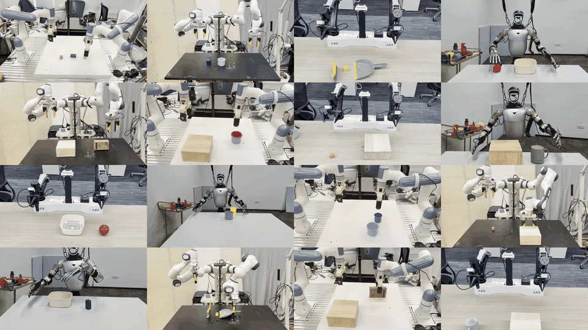
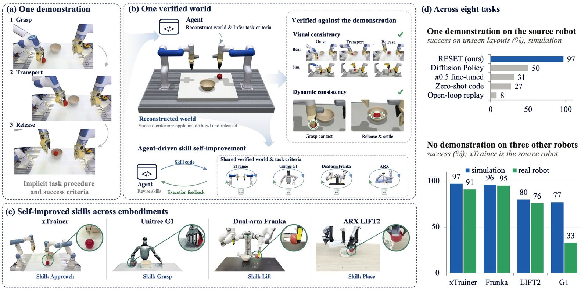
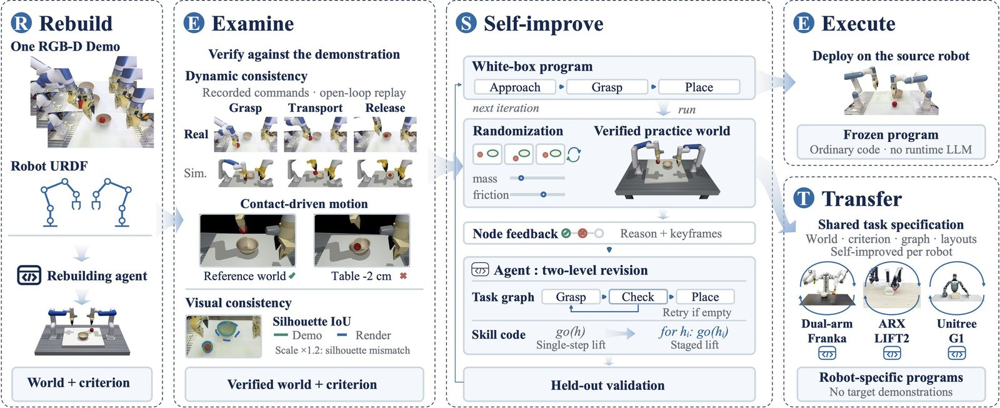
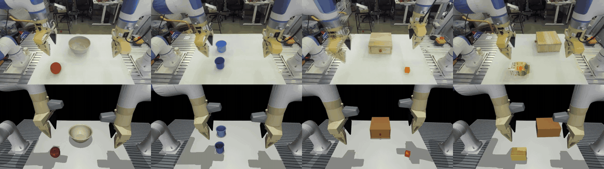
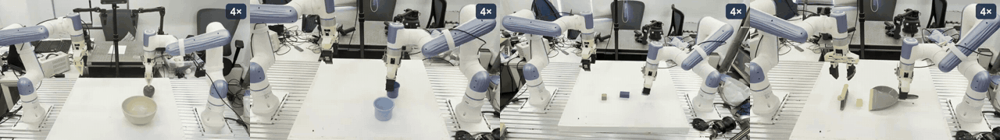
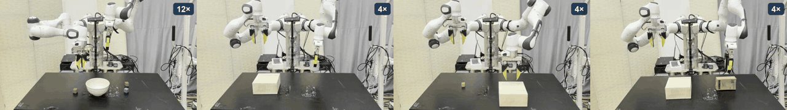
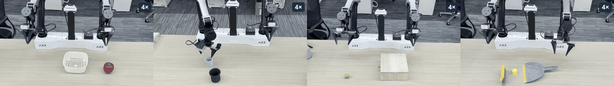
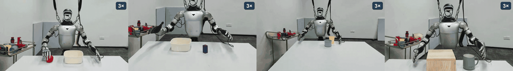

<div align="center">

# RESET

### One Demonstration, One Verified World, Self-Improved Skills Across Embodiments

Zheng Sun<sup>1\*</sup>, Zhuo Li<sup>1\*</sup>, Zhihao Li<sup>1\*</sup>, Heng Yi Sim<sup>1</sup>, Ge Wang<sup>2</sup>, Ziyue Zhu<sup>3</sup>, Mingkai Jia<sup>4</sup>, Fei Chen<sup>1</sup>

<sup>1</sup>The Chinese University of Hong Kong &nbsp; <sup>2</sup>The Chinese University of Hong Kong, Shenzhen &nbsp; <sup>3</sup>Nankai University &nbsp; <sup>4</sup>The Hong Kong University of Science and Technology
<br><sup>\*</sup>Equal contribution

[](https://arxiv.org/abs/2611.31894)
[](https://zainzh.github.io/RESET/)
[](https://zainzh.github.io/RESET/#video)
[](LICENSE)



<sub>Frozen programs running on four real robots: xTrainer, Dual-arm Franka, ARX LIFT2 and Unitree G1 (sped up).</sub>

</div>

## Overview

**One real demonstration is enough to teach a task to four different robots.** RESET turns the demonstration into a
contact-rich simulated world, checks that world against the demonstration, and lets coding agents self-improve
white-box skill programs inside it. The same verified world is shared with robots that were never demonstrated to;
the frozen programs then run on the real robots with no LLM call at run time.

<p align="center"></p>

| | Step | What happens |
|:-:|---|---|
| **R** | Rebuild | Reconstruct the world and a frozen, read-only success criterion from one demonstration. |
| **E** | Examine | Replay the demonstration open-loop and compare silhouettes to verify the world. |
| **S** | Self-improve | Practice on randomized layouts; revise the task graph and skill code from per-node failures. |
| **E** | Execute | Run the frozen program on the real robot, as ordinary code. |
| **T** | Transfer | Give the same world and criterion to other robots, with no new demonstration. |

<p align="center"></p>

## Results

**From one demonstration to a learned program.** Top: the single real demonstration of each task.
Bottom: the learned program completing the task in the world rebuilt from it.

<p align="center"></p>

**On real robots.** The same frozen programs succeed in **223 of 280** real-robot trials (80%), including three
robots that received no demonstration.

<table>
<tr><td align="center"><b>xTrainer</b> &middot; source robot, one demonstration per task &middot; <b>73/80</b><br></td></tr>
<tr><td align="center"><b>Dual-arm Franka</b> &middot; no demonstration &middot; <b>76/80</b><br></td></tr>
<tr><td align="center"><b>ARX LIFT2</b> &middot; no demonstration &middot; <b>61/80</b><br></td></tr>
<tr><td align="center"><b>Unitree G1</b> &middot; no demonstration &middot; <b>13/40</b> (4 tasks)<br></td></tr>
</table>

**In simulation**, on 50 unseen layouts per task, RESET reaches **97%** on the source robot, against 50% for
Diffusion Policy, 31% for fine-tuned &pi;<sub>0.5</sub> and 27% for zero-shot code. More videos are on the
[project page](https://zainzh.github.io/RESET/).

## This repository

This release reproduces the **simulation results** of the paper: the rebuilt worlds, the 32 frozen programs
(4 robots × 8 tasks), the trusted episode runners, the frozen task scorers and the exact TEST layouts.
The agent pipeline (Rebuild / Examine / Self-improve), the raw demonstrations and the real-robot stack are not
included.

<table>
<tr><th>Robot</th><th>Apple</th><th>Cubes</th><th>Stack Cups</th><th>Build Tower</th><th>Mug-Box</th><th>Open Drawer</th><th>Sweep</th><th>Lift-Box</th><th>Mean</th></tr>
<tr><td>xTrainer (source, 1 demo per task)</td><td>100</td><td>98</td><td>96</td><td>100</td><td>100</td><td>100</td><td>88</td><td>94</td><td><b>97</b></td></tr>
<tr><td>Dual-arm Franka (no demo)</td><td>94</td><td>98</td><td>100</td><td>100</td><td>94</td><td>100</td><td>78</td><td>100</td><td><b>96</b></td></tr>
<tr><td>ARX LIFT2 (no demo)</td><td>86</td><td>76</td><td>90</td><td>92</td><td>84</td><td>70</td><td>58</td><td>80</td><td><b>80</b></td></tr>
<tr><td>Unitree G1 (no demo)</td><td>86</td><td>70</td><td>100</td><td>70</td><td>80</td><td>100</td><td>32</td><td>80</td><td><b>77</b></td></tr>
</table>

<sub>Success rate (%) over 50 unseen TEST layouts per task, in simulation.</sub>

## Installation

Requirements: Linux x86-64 and an NVIDIA GPU with EGL (headless rendering). Two Python environments are needed,
because the G1 programs were frozen with MuJoCo 3.3.7 and the other robots with MuJoCo 3.2.3:

```bash
git clone https://github.com/ZainZh/RESET.git && cd RESET

# Python 3.12: xTrainer, Franka, LIFT2
python3.12 -m venv .venv     && .venv/bin/pip install -r requirements.txt
# Python 3.11: Unitree G1
python3.11 -m venv .venv-g1  && .venv-g1/bin/pip install -r requirements-g1.txt
```

<details>
<summary>No <code>python3.12-venv</code> or no Python 3.11 on the machine? Use conda instead.</summary>

```bash
conda create -y -p ./py312 python=3.12 && ./py312/bin/python -m venv .venv    && .venv/bin/pip install -r requirements.txt
conda create -y -p ./py311 python=3.11 && ./py311/bin/python -m venv .venv-g1 && .venv-g1/bin/pip install -r requirements-g1.txt
```
</details>

**SAM3.** The programs segment objects with [SAM3](https://github.com/facebookresearch/sam3) through a small shared
server. SAM3 and its checkpoint are not redistributed: request access to the gated checkpoint on Hugging Face
(`facebook/sam3`), log in with `hf auth login`, download `sam3.pt` (`hf download facebook/sam3 sam3.pt`), and set up the server environment as in
[docs/SAM3_SERVICE.md](docs/SAM3_SERVICE.md). Then start it:

```bash
export RSI_SAM3_ADDR=/tmp/sam3.sock
SAM3_CHECKPOINT=/path/to/sam3.pt PYTHONPATH=. .venv-sam3/bin/python -m rsi.sam3_service   # prints "SAM3_SERVICE ready"
```

## Reproducing the results

With the SAM3 server running, in a second shell:

```bash
export RSI_SAM3_ADDR=/tmp/sam3.sock

# one cell: Franka, Stack Cups, all 50 TEST layouts
.venv/bin/python eval.py --robot franka --task stack_cups --layouts test

# a few layouts, more parallel episodes
.venv/bin/python eval.py --robot g1 --task lift_box --layouts test --seeds 0-9 --workers 4

# all 32 cells, then the table next to the paper's numbers
.venv/bin/python eval.py --all --layouts test --workers 3
.venv/bin/python eval.py --table
```

Robots: `xtrainer`, `franka`, `lift2`, `g1`.
Tasks: `collect_apple`, `collect_cubes`, `stack_cups`, `build_tower`, `put_mug_on_box`,
`open_drawer_and_place_object`, `sweep_objects`, `lift_box`.
Results are written to `results/<robot>/<task>/<run>/`.

**Memory sets the number of workers.** Each episode is one process. xTrainer and Franka episodes need under 1 GB,
but LIFT2 episodes briefly peak at 10-16 GB and G1 episodes at 6-8 GB. Choose `--workers` from free RAM: about
free RAM / 16 GB for LIFT2 and / 8 GB for G1 (3 on a 64 GB machine); xTrainer and Franka can use many more.

An episode takes 10 s to about 2 min on one CPU core (a few LIFT2 episodes up to about 14 min). On an RTX 4090 with
4 workers, one 50-layout cell takes 2-10 min for xTrainer, Franka and G1, and about an hour for LIFT2 Apple.

Simulation is not bitwise reproducible across machines and GPU drivers, so a few seeds near a decision boundary can
flip; expect per-cell rates close to the table rather than identical.

The paper's numbers were produced on NVIDIA H800 GPUs; on other GPUs or drivers a few seeds can differ
(see [NOTES.md](NOTES.md#test-environment)).

## Documentation

| | |
|---|---|
| [docs/DETAILS.md](docs/DETAILS.md) | all `eval.py` options and environment variables, runtime, reproducibility, and disclosures (what programs may read, G1 specifics, demonstration priors) |
| [docs/SAM3_SERVICE.md](docs/SAM3_SERVICE.md) | setting up the SAM3 server, and the protocol for replacing it |
| [docs/REPOSITORY.md](docs/REPOSITORY.md) | repository layout and the G1 program entry modules |
| [NOTES.md](NOTES.md) | the 32 frozen programs and the changes made for this release |
| [THIRD_PARTY.md](THIRD_PARTY.md) | third-party robot models and assets, with their licences |

## Related work

**ReSkill: Selective Self-Improvement for Robot Manipulation**, our earlier work on robot self-improvement.
[Paper](https://arxiv.org/abs/2611.10510) &middot; [Project page](https://zainzh.github.io/ReSkill/)

## Citation

```bibtex
@article{sun2026reset,
  title   = {RESET: One Demonstration, One Verified World, Self-Improved Skills Across Embodiments},
  author  = {Sun, Zheng and Li, Zhuo and Li, Zhihao and Sim, Heng Yi and Wang, Ge and Zhu, Ziyue and Jia, Mingkai and Chen, Fei},
  journal = {arXiv preprint arXiv:2611.31894},
  year    = {2026}
}

@article{sun2026reskill,
  title   = {ReSkill: Selective Self-Improvement for Robot Manipulation},
  author  = {Sun, Zheng and Li, Zhihao and Li, Zhuo and Liu, Wenrui and Wang, Xin and Chen, Fei},
  journal = {arXiv preprint arXiv:2611.10510},
  year    = {2026}
}
```

## License

Code: [MIT](LICENSE). Third-party robot models and assets keep their own licences; see [THIRD_PARTY.md](THIRD_PARTY.md).
